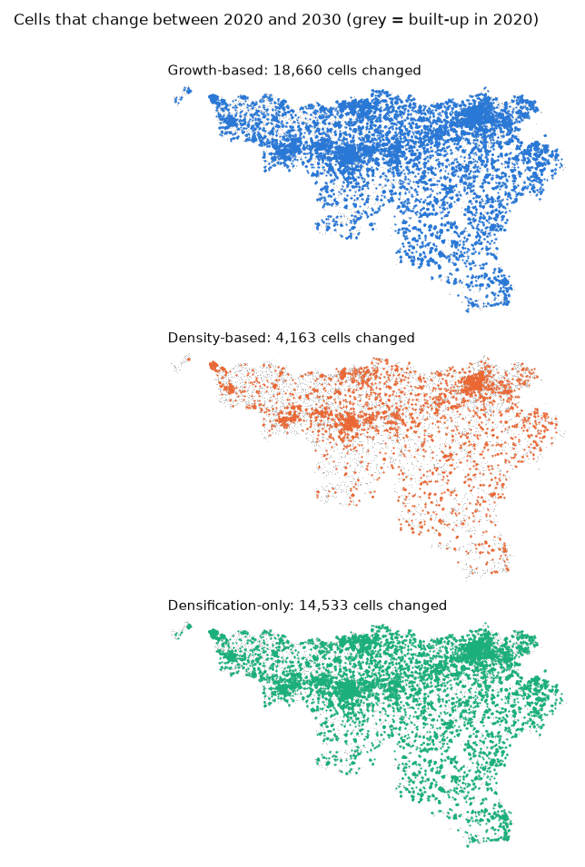
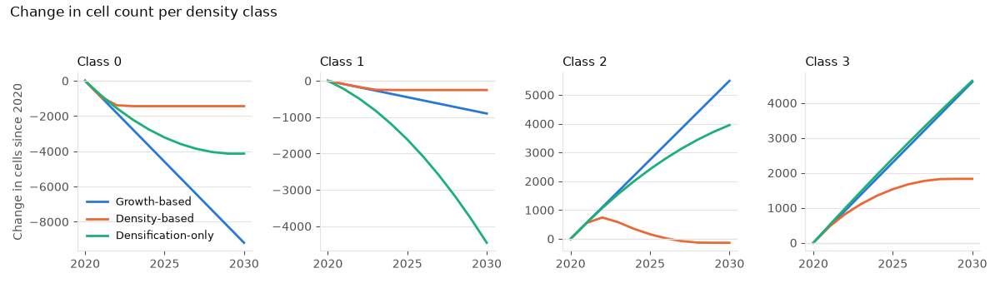
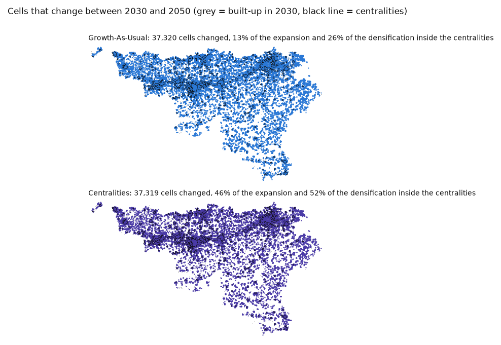
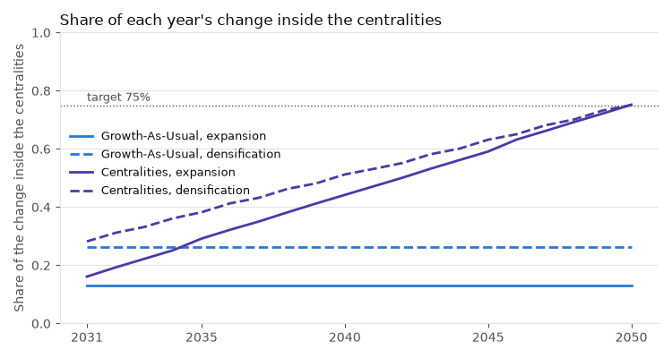

# SuSceMod
SuSceMod is a codebase meant for <ins>Su</ins>stainable <ins>Sce</ins>nario <ins>Mod</ins>elling of urban built-up.
This Python code is a part of the Sustainable Densification project. This code calibrates and models futuristic urban growth at a regional scale.

## Installation
From the root of this repository:
```
pip install -e .
```
This installs `numpy`, `pandas`, `rasterio`, `matplotlib`, `seaborn`, `openpyxl`, `tabulate`, `scikit-learn` and `scikit-image`. It needs Python 3.10 or newer and was tested with Python 3.13. To run the example notebooks you also need Jupyter.

## Quick start
This runs the densification-only scenario for 2020 to 2030, using the example rasters in `SuSceMod/examples/`:
```python
import os
from SuSceMod.simulation import data_utilities, input_handling, scenarios

initial_map = data_utilities.load_raster_data("input_rasters/BU_2020.tif")
prob_maps, _ = input_handling.load_prob_maps("suitability_maps/10_20/")

# Annual demand (cells/year) for every transition, from two historical maps
change_maps, _ = input_handling.calculate_change_maps("input_rasters/BU_2010.tif", "input_rasters/BU_2020.tif")
annual_rates, _, _ = input_handling.calculate_change_rates(change_maps, [2010, 2020])

os.makedirs("output", exist_ok=True)
maps, paths, class_counts = scenarios.simulate_densification_only_scenario(
    2020, 2030, initial_map, prob_maps, annual_rates, "output/", randomness="gumbel", seed=2118
)

# Save the simulated maps, using the initial map as the template for extent and projection
for year, sim in maps.items():
    data_utilities.writeraster("input_rasters/BU_2020.tif", paths[year], sim)
```
The growth-based scenario takes the same arguments. The density-based scenario also takes `differential_change_rates` after `annual_rates`. See the notebooks in `examples/` for each one.

## Input data
- **Built-up maps:** single-band rasters on the same grid. Cells hold a density class: 0 for empty and 1, 2, 3 for increasing built-up density. Cells outside the study area are NaN.
- **Suitability maps:** one raster per transition, named like `suitability_ref0_to_1.tif` (from class 0 to class 1). Each is divided by its own maximum, so values end up between 0 and 1. For the example, the transitions are 0→1, 0→2, 0→3, 1→2, 1→3 and 2→3.
- **Water mask (optional):** a raster on the same grid where cells equal to 1 are never changed. Pass it as `water_zone` to any scenario.
- **Centralities raster (centralities scenario):** a raster on the same grid, 1 inside the centralities and 0 outside.
- **Demand:** the number of cells that change per year for each transition. You can calculate it from two or three historical built-up maps with `input_handling`, or pass your own values as a dictionary such as `{(0, 1): 490.6, (1, 2): 561.3}`.

## Results of the examples
Cells that change between 2020 and 2030 in each example scenario:



Change in the number of cells per density class:



Growth-As-Usual against Centralities, both from the same map of 2030, with the same demand and the same seed. Growth-As-Usual keeps the historical share inside the centralities, 13% of the expansion and 26% of the densification. The centralities scenario moves that share in equal yearly steps to 75% by 2050. Both change about 37,300 cells between 2030 and 2050, but with Growth-As-Usual 13% of the expansion and 26% of the densification are inside the centralities, and with Centralities 46% and 52%:





The figures are made by `docs/make_figures.py` from the saved results in `SuSceMod/examples/output/`. The two figures of the centralities scenario also need `BU_centralities.tif` and `ex_Zone_eau_binary.tif` in `input_rasters`.

## Tests
```
pip install -e ".[test]"
pytest
```
`tests/test_scenarios.py` runs in a few seconds on small synthetic maps. `tests/test_examples.py` takes about a minute and checks that the three example scenarios reproduce the results saved in `SuSceMod/examples/output/`.

## Folders
### 📂 `simulation/`
This is the main engine for the simulation. It is split by what each part decides:

- `scenarios.py`: the four scenarios you call. Each one fixes how much demand there is every year, then runs the same yearly loop.
- `demand.py`: the demand rules (constant, trend, phased-out expansion), the yearly share inside the centralities, and the split of the demand into inside and outside.
- `allocation.py`: how one year of change is placed on cells, with the water mask and the centralities as zones. It holds both ways of choosing the cells: ranking, which is the default, and the original acceptance rule.
- `input_handling.py`, `data_utilities.py`, `logger.py`: loading the rasters and the demand, saving the outputs, and logging.

The scenarios in `scenarios.py`:
- `simulate_growth_based_scenario` (Growth-As-Usual, GAU): keeps the historical annual demand for every transition constant
- `simulate_density_based_scenario` (Business-As-Usual, BAU): changes the demand every year, following the trend between two historical periods
- `simulate_densification_only_scenario` (Densification Only, DO): reduces the demand for expansion (class 0 to 1, 2 and 3) linearly to zero by the final year. The cells this frees up are added to the densification demand (1 to 2, 1 to 3 and 2 to 3)
- `simulate_centralities_scenario`: keeps the demand constant, as in GAU, but allocates a growing share of it inside the centralities. The share moves in equal yearly steps from its starting value to a target, 75% by default. Measure the starting share from two maps with `input_handling.calculate_central_shares`

**Forcing a share inside the centralities.** GAU, BAU and DO also take `central_zones` and `central_shares`, a pair `[expansion, densification]`. The demand is then split every year with that same share, which keeps the historical share as it is. For example, `simulate_growth_based_scenario(..., central_zones=zones, central_shares=[0.13, 0.26])` is GAU with the historical split. With DO, each zone's cancelled expansion turns into that zone's own densification.

**Other options.** Every scenario also takes `water_zone` (cells equal to 1 never change). `randomness` chooses how the cells are chosen. `"gumbel"` (the default), `"jitter"` and `"none"` give each demand to the cells with the highest score, which is the transition potential plus noise, and `tau` (default 0.1) sets the size of the noise. `"acceptance"` is the original rule of the model: cells are visited in order of potential, and a cell is accepted if its potential is above a random number times a temperature that cools after every pass, until the demand is met. It uses no noise, so `tau` does not apply, and demands are rounded down.

### 📂 `analysis/`
This folder contains Python scripts focused on analysis, visualization and accuracy assessment of simulated urban built-up data.

### 📂 `examples/`
Examples for modelling growth-based, density-based, densification-only and centralities scenarios, using jupyter notebooks and example rasters. The results of running the growth-based, density-based and densification-only notebooks are saved in `examples/output/`, in one subfolder per scenario, to compare against your own runs. The centralities notebook needs two more rasters in `input_rasters`, `BU_centralities.tif` and `ex_Zone_eau_binary.tif`, which are not included.
